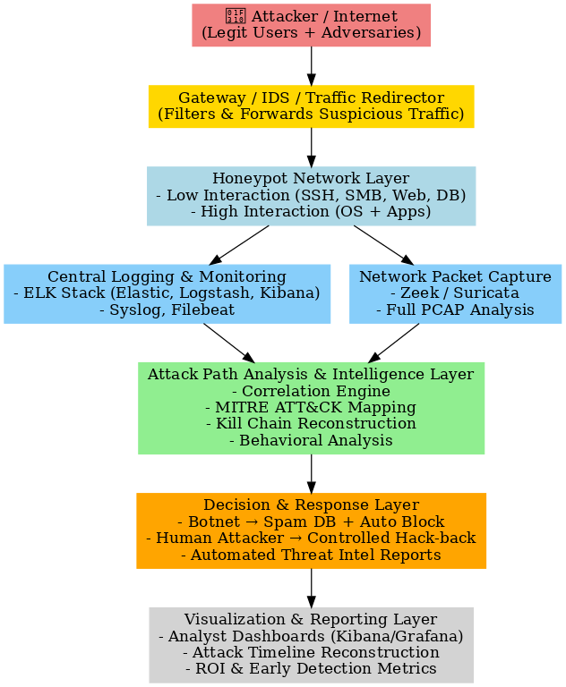

# Smart Honeypot System — Threat Detection & Attack Path Analysis

M.S. Cybersecurity Capstone (CYB 6500), Yeshiva University — Katz School of Science and Health

A stealth-capable honeynet built to lure real attackers into an isolated environment, capture their behavior, and turn it into actionable threat intelligence. Instead of reacting after damage is done, the system studies adversary tactics, techniques, and procedures (TTPs) as they happen, reconstructs the full attack path, and maps every observed behavior to the MITRE ATT&CK framework.

The system was deployed live, demonstrated to stakeholders for evaluation, and then taken down to control cloud costs.

## Architecture



Traffic flows through the system in layers:

1. **Gateway / IDS / Traffic Redirector** — filters incoming traffic and forwards suspicious sessions into the honeynet.
2. **Honeypot Network Layer** — low-interaction services (SSH, SMB, Web, DB) and high-interaction systems (full OS + applications), containerized with Docker and hardened with anti-fingerprinting techniques so the decoys resist detection by tools such as Shodan.
3. **Central Logging & Monitoring** — ELK Stack (Elasticsearch, Logstash, Kibana) with Syslog and Filebeat shipping events from every honeypot.
4. **Network Packet Capture** — Zeek and Suricata with full PCAP analysis running alongside the logging pipeline.
5. **Attack Path Analysis & Intelligence Layer** — a correlation engine that performs MITRE ATT&CK mapping, kill-chain reconstruction, and behavioral analysis; Neo4j is used to model and visualize attacker movement as a graph.
6. **Decision & Response Layer** — automated handling by attacker type (for example, botnet traffic routed to spam databases and auto-blocked) and automated threat intelligence report generation.
7. **Visualization & Reporting Layer** — analyst dashboards (Kibana / Grafana), attack timeline reconstruction, and early-detection metrics.

## Honeypots & Tooling

| Area | Tools |
|---|---|
| Honeypots | Cowrie (SSH), Dionaea, OpenCanary, T-Pot, custom web emulators |
| Detection / Capture | Zeek, Suricata, full PCAP analysis |
| Logging & SIEM | ELK Stack (Elasticsearch, Logstash, Kibana), Filebeat, Syslog |
| Analysis | Python, Neo4j (attack-path graph), MITRE ATT&CK mapping, STIX/TAXII |
| Infrastructure | Docker, Linux, isolated virtual network |

## Sample Data

`data/honeypot_attacks_sample.ndjson` contains a sample export of **1,200 structured attack events** captured by the pipeline. Each event is a JSON record with source metadata, session and flow IDs, the observed attacker actions, a severity verdict, and its MITRE ATT&CK tactic and technique mapping, for example:

```json
{
  "timestamp": "2025-09-03T20:22:47Z",
  "protocol": "tcp",
  "dest_port": 53,
  "payload_snippet": "Attempt to escape container via mounting /proc and running unshare; probes for CVE-2025-CTR",
  "verdict": "high",
  "observed_actions": ["container-escape-probe", "privilege-escalation-attempt"],
  "mitre_tactic": "Lateral Movement",
  "mitre_technique": "Escape Container"
}
```

IP addresses in the sample are anonymized, so the dataset is safe to share for research and learning.

## Repository Contents

- `docs/final_report.pdf` — full capstone report: problem analysis, system design, business case, and outcomes
- `docs/project_proposal.docx` — original project proposal
- `docs/presentation.pptx` / `docs/presentation_full.pptx` — capstone presentation decks
- `demo/demo.mp4` — demonstration video of the live system
- `assets/architecture.png` — system architecture diagram
- `data/honeypot_attacks_sample.ndjson` — sample of 1,200 captured attack events (anonymized)

## Key Deliverables

- Live, operational honeynet resisting fingerprinting while capturing attacker traffic in an isolated environment
- Attack path visualization dashboard (Neo4j correlation) showing the sequence of attacker actions
- Threat intelligence reports generated from captured activity, with TTPs mapped to MITRE ATT&CK
- ROI analysis quantifying the value of early detection (shorter dwell time, lower remediation cost)
- Deployment guide and final capstone report

## Notes & Ethics

This project was built and run in an isolated lab environment for academic research and defensive purposes only. The counter-engagement ("backtracking") module described in the report is a **proposed future-work design** for authorized government attribution contexts — it was simulated in the lab only and is not an operational tool in this repository.

## Author

**Syed Abdul Malik** — M.S. Cybersecurity, Yeshiva University
[LinkedIn](https://www.linkedin.com/in/syed-abdul-malik-5837981b8/) · [Portfolio](https://portfolio-syed.lovable.app)
